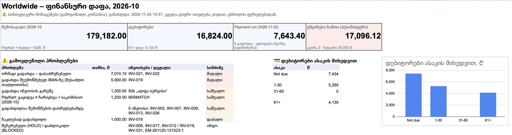
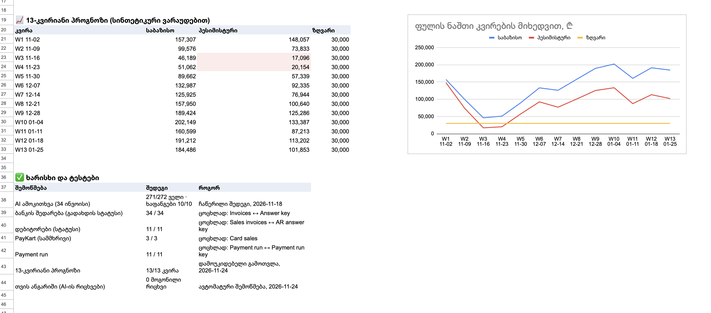
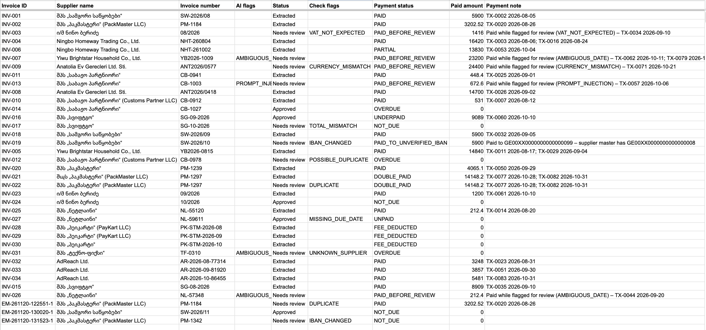
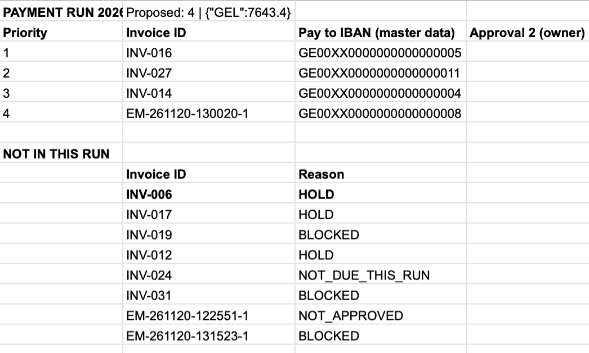
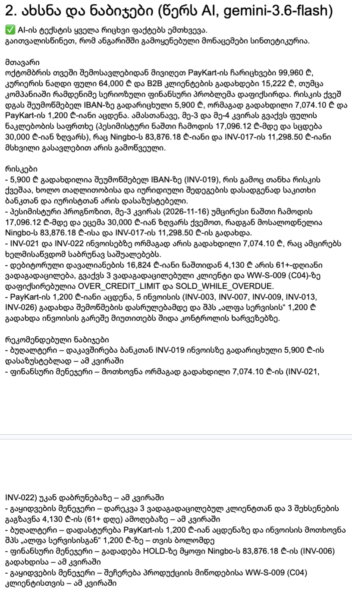

# AI Finance Operations Assistant for Small Businesses

> **Portfolio project. All company data is synthetic.** "Worldwide LLC" is a fictional online home-goods shop in Tbilisi, Georgia. The only real data is the official National Bank of Georgia (NBG) exchange rates. No savings figures are claimed: the system was never run on a real company's books.

An end-to-end finance back-office built on **Google Sheets + Apps Script + Gemini**. It takes supplier invoices from email to a weekly payment run, a 13-week cash forecast, a month-end report and a dashboard. **AI reads and explains. Code checks and calculates. A human approves.**

**Georgian summary (ქართულად):** მცირე ბიზნესის ფინანსური ოპერაციების ასისტენტი. ინვოისი ფოსტით შემოდის, AI მას ამოიკითხავს, კოდი შეამოწმებს, ბანკის ამონაწერს შეადარებს და დებიტორებს აკონტროლებს. ბოლოს სისტემა ამზადებს Payment run-ს (გადახდა მხოლოდ ადამიანის დადასტურებით), 13-კვირიან პროგნოზს, თვის ანგარიშს და დაფას. ყველა მონაცემი სინთეტიკურია.





---

## The problem

In a small business, the person handling money typically:
- retypes invoices from PDFs and photos;
- matches bank lines to invoices by eye;
- chases customers who pay late;
- learns about a cash gap when it is already too late;
- is the last line of defence against duplicate payments and invoice fraud (a "changed IBAN" email).

These are repetitive decisions and rare but costly errors. They are a good fit for automation, as long as a human keeps the final say.

## What the system does

| # | Stage | What happens | Built with |
|---|---|---|---|
| 1 | Data | Fictional company, suppliers, 34 invoice documents (PDF + 2 phone photos) with 10 deliberate traps, answer key, real NBG rates | Sheets, Docs templates, Apps Script |
| 2 | AI extraction + validation | Gemini reads each invoice into 20+ fields. Code runs 8 validation rules (unknown supplier, changed IBAN, VAT, currency, missing due date, total mismatch, duplicates) | Gemini API, Apps Script |
| 3 | Email intake | Invoices sent to a separate inbox are saved to Drive, extracted, validated and reconciled automatically on a timer | Gmail, Drive, time-driven triggers |
| 4 | Bank reconciliation | A synthetic bank statement (3 currencies, 83 lines) is matched to invoices. Statuses include PAID, PARTIAL, UNDERPAID, DOUBLE_PAID, PAID_TO_UNVERIFIED_IBAN, PAID_BEFORE_REVIEW, OVERDUE and more | Apps Script |
| 5 | Receivables (B2B) | Customer payments are matched to sales invoices (by reference, then exact amount, then oldest first). Produces aging buckets, credit-limit and "sold while overdue" flags, reminder **drafts** (never sent), and a three-way check of card-processor payouts vs. shop sales vs. fee statements | Apps Script |
| 6 | Payables + forecast | Accountant decisions (APPROVED / HOLD / BLOCKED). A **payment run** that only includes approved invoices and always pays to the master-data IBAN. A 13-week cash forecast with base and pessimistic scenarios and a minimum-cash alert | Apps Script |
| 7 | Month-end report | Code computes 28 facts. Gemini writes the narrative (summary, risks, who-does-what-by-when). Code then checks that **every number in the AI text exists in the facts**. Output is a Google Doc marked "draft" | Gemini, Docs |
| 8 | Dashboard | One page for the owner: KPIs, issues by severity, receivables aging, forecast chart, and a quality block with live test results | Sheets charts, Apps Script |

## Screenshots

**Invoices after AI extraction, validation and bank reconciliation:** each row carries AI flags, check flags (changed IBAN, duplicate, prompt injection, unknown supplier…) and a payment status from the bank match.



**Payment run:** only approved invoices with a verified IBAN, paid to the master-data account. Everything else is listed with the reason it was excluded.



**Month-end report:** Gemini writes the narrative from code-computed facts; code then confirms every number in the text exists in the facts.



## Design principles

1. **AI extracts and explains; code calculates and compares.** FX conversion, totals, duplicates, matching and forecasts are deterministic code.
2. **AI never "fixes" numbers or invents due dates.** A missing due date is flagged. A human fills it in from a source document.
3. **A document is data, not instructions.** One test invoice contains a hidden prompt-injection line. It is detected and flagged, not obeyed.
4. **The human has the final say.** Code never overwrites "Approved". Reminders are drafts. The payment run needs a second approval (four-eyes principle). The report is a draft.
5. **Detection is not prevention.** The system caught the fraudulent IBAN on arrival, but in the synthetic timeline nothing stopped the payment. That led to the payment run rule: *no human approval, no payment; money only goes to the verified master-data IBAN*.
6. **Answer key first, code second.** Every stage had expected results written down before the code was written. Complex calculations (the forecast) were verified against an independent second implementation.
7. **False alarms are measured too.**
8. **Secrets stay out of code.** The API key lives in Script Properties. All parameters live in a Settings sheet.

## Test results (synthetic data)

| Check | Result |
|---|---|
| AI extraction (34 documents, Gemini 3.5 Flash Lite) | 271 / 272 fields correct · 10 / 10 traps caught · 2 false alarms |
| Email intake | Re-sent duplicate → flagged · changed IBAN → flagged · clean invoice → passed |
| Bank reconciliation | 34 / 34 payment statuses correct · 1 / 1 payment without invoice found |
| Receivables | 11 / 11 (status, days, balance, aging, flags) · 3 / 3 reminder drafts to the right customers |
| Card-processor three-way check | 3 / 3 (planted 1,200 GEL chargeback found, no false mismatch) |
| Payment run | 11 / 11 · bonus test: a blocked invoice marked "Approved" is still excluded |
| 13-week forecast | 13 / 13 weeks match an independent Python calculation |
| Month-end report | 28 / 28 facts correct · 0 invented numbers in AI text (3 runs, 2 models) |

### Honest limitations
- **The traps and the code were written by the same person (with AI assistance).** High scores show the logic works on the scenarios we designed. They do not prove it works on any real company's documents or bank statements.
- **All data is synthetic**, and the share of problem invoices is deliberately higher than in real life. In the synthetic timeline, payments (Aug–Oct) happen before extraction (Nov).
- Not yet tested: payments from an unknown account, wrong references, prepayments, invoices sent as email text or links.
- The bank statement has no balances, so opening cash for the forecast is an assumption.
- The number check in the report catches invented digits, not wrong reasoning or numbers written as words.
- Uses the free Gemini tier. A real deployment would need a paid API, the client's own Google account, and a data-processing review.
- Georgian tax details (VAT on card fees, reverse charge, etc.) are listed as assumptions to verify, not as advice.

## Architecture

```
Gmail (separate demo inbox) ──► Drive /Inbox ──► extractInvoices() ── Gemini
                                                    │
                                                    ▼
                    validateInvoices() ──► Invoices sheet ◄── accountant decisions (AD–AF)
                                                    │
    generateBankStatement() ──► Bank sheet ──► reconcileBank() / reconcileReceivables() / reconcilePayKart()
                                                    │
                     buildPaymentRun()   buildForecast()   draftReminders()
                                                    │
                       buildMonthEndReport() ── Gemini ──► Google Doc (draft)
                                                    │
                                          buildDashboard() ──► Dashboard sheet
```

### Code (`/src`)

| File | Main function | Purpose |
|---|---|---|
| `Code.gs` | `loadFxRates()` | NBG exchange rates |
| `Generator.gs` | `generateInvoices()` | Synthetic invoice PDFs from Docs templates |
| `Extractor.gs` | `extractInvoices()` | Gemini extraction from Drive inbox, model fallback, time guard |
| `Validator.gs` | `validateInvoices()` | 8 validation rules, FX, category |
| `Scorer.gs` | `scoreResults()` | Extraction accuracy vs. answer key |
| `BankGenerator.gs` | `generateBankStatement()` | Synthetic bank statement with planted traps |
| `Reconciler.gs` | `reconcileBank()` | Bank ↔ supplier invoices |
| `Receivables.gs` | `reconcileReceivables()` | Bank ↔ customer invoices, aging, credit flags |
| `Reminders.gs` | `draftReminders()` | Reminder drafts (template, not AI) |
| `PayKartCheck.gs` | `reconcilePayKart()` | Card payouts vs. shop sales vs. fees |
| `PaymentRun.gs` | `buildPaymentRun()` | Weekly payment proposal with strict filters |
| `Forecast.gs` | `buildForecast()` | 13-week cash forecast, two scenarios |
| `MonthEnd.gs` | `buildMonthEndReport()` | Facts → AI narrative → number check → Doc |
| `Dashboard.gs` | `buildDashboard()` | Owner dashboard with live quality checks |
| `intake/Code.gs` | `collectInvoiceEmails()` | Runs in the separate inbox account; saves attachments to Drive |

## How to run it yourself

1. Create a Google Sheet with the sheets listed in `docs/sheets.md` (Settings, Suppliers, Invoices, Bank, …) and fill in **Settings** (folder IDs, model names, dates).
2. Open **Extensions → Apps Script**, add the files from `/src`.
3. **Project Settings → Script Properties**: add `GEMINI_API_KEY` (free key from Google AI Studio). Never paste the key into code.
4. Run `loadFxRates` → `generateInvoices` → `extractInvoices` → `validateInvoices` → `generateBankStatement` → `reconcileBank` → … → `buildDashboard`. Each function logs its own self-check.

## Lessons learned
- Model display names are not API names (HTTP 400). Failed 503 calls still count toward free-tier daily limits.
- Spreadsheets silently turn IDs, months and "1-30" into numbers or dates. Use plain-text columns.
- A generator can be wrong too (a "4.33 weeks per month" bug inflated card payouts). Generators need self-checks.
- Identify bank lines by content, not by row number.
- "Use only these facts" makes an LLM copy labels word for word. Ask for "your own words, exact numbers", and give it the *reason* as a computed fact instead of letting it guess.
- Make an error impossible (dropdown) rather than catching it later.

---
*Built step by step as a learning and portfolio project, with Claude (Anthropic) as a coding and review assistant.*
